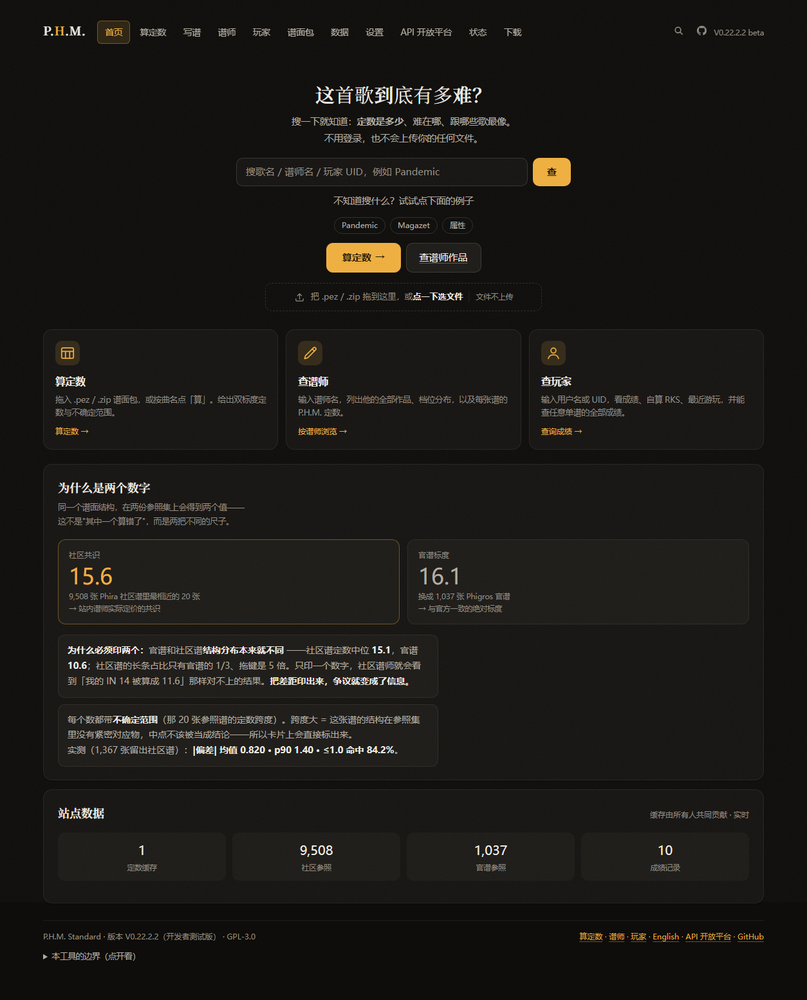
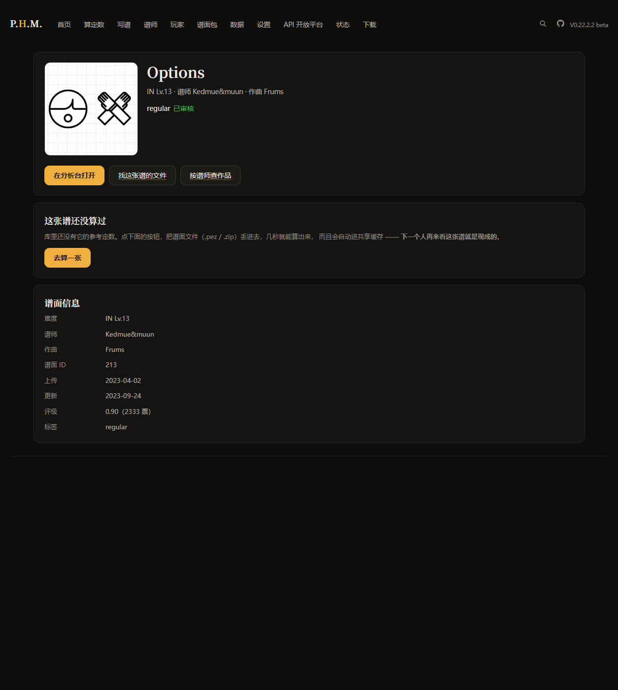

# P.H.M. — Phira Huamei Metric

<p align="center">
  
</p>

<p align="center">
  <a href="https://phm.app.workbuddy.host/"><b>▶ 在线使用</b></a> ·
  <a href="phm-web/docs/HANDOVER.md">改代码先读这个</a> ·
  <a href="phm-web/CHANGELOG.md">更新记录</a> ·
  <a href="phm-web/docs/ENGINE-EXPERIMENT.md">被否掉的方案</a>
</p>

<p align="center">
  
  
  
  
</p>

> 为 Phira / Phigros 谱面提供**可审计的难度参考**。
> 拖入谱面包，得到一个客观数值 + 它匹配到的官谱参照。
> **不给判决。**

> ## 👉 要改代码？先读 [`phm-web/docs/HANDOVER.md`](phm-web/docs/HANDOVER.md)
>
> 那份是**部署前必做什么**和**做了就出事的红线**清单（版本号、缓存、白名单、
> 生成物、CSS 花括号……），每一条后面都跟着一次真实事故。
> 本文件只讲产品定位，不讲操作纪律。

**版本：见 [`phm-web/CHANGELOG.md`](phm-web/CHANGELOG.md)**（唯一真源）
> ⚠ 这里**故意不写死版本号** —— 以前写死过，然后就落后了 8 个版本，
> 下一个人照着旧号判断"现在是什么版本"就会错。
> 当前线上版本随时可查：`curl -s https://phm.app.workbuddy.host/ | grep app-version`
>
> V0.22.0.0（2026-10-23）参照维度 **8 → 37**：引擎一早算出了 39 个特征，只是一直只用了 8 个。
> V0.4.0（2026-10-07）那次是**引擎级**变更：参照集从「1,037 张官谱 × 4 维」
> 换成「9,508 张社区谱 × 8 维」，并改为**双标度输出**。
> 方法与全部被否掉的方案见 `phm-web/docs/ENGINE-EXPERIMENT.md`。
> ⚠ 换标度后新旧数字**不可比**，缓存已全量重算。

**在线使用**：<https://phm.app.workbuddy.host/> （打开即用，无需安装）

---

<p align="center">
  
</p>

> 谱面页会同时给出**三个互相独立的数**：引擎按谱面结构算的、玩家实际打出来的、
> 以及谱师自己写进文件里的。三者不一致时，页面会直接说明差在哪 —— 而不是把判断丢给你。

## 一句话定位

**本工具不判定「虚标」。** 这不是谦辞，是可测量的结论 —— 但**理由必须写对**：

| 事实 | 数值 | 它到底说明什么 |
|---|---|---|
| 37 维结构能解释声明定数的方差 | **R² = 0.46** | 结构最多只能解释声明定数的 46% |
| 解释不了的那部分里，「谱师是谁」占 | **约 60%** | 声明定数里最大的一块是**标定者的习惯**，不是这张谱本身 |
| 网页版不确定带的实测覆盖率 | **90.9%**（半宽中位 ±1.50 级） | 这个带**可以直接当区间读**（它取的是 20 个近邻的 min/max） |

也就是说：一条声明定数 = 结构 + 谱师习惯 + 说不清的那部分。
**任何只看谱面的工具都不该假装能把它拆开** —— 所以本工具的定位是
**结构相似性检索**，输出是「参照」而不是「判决」。
声称能区分「谱师标错」与「官方也会这么标」就是造假。

> ⚠️ **旧版这里的统计要作废，别再引用**：
>
> ① 「官方标注噪声 2.80 级」 —— 它量的是**相邻档位的设计差**，不是同一难度上的
> 重复标注。拆开看：EZ→HD 中位 **4.60** / HD→IN **3.50** / IN→AT **1.10**，合计 2.60，
> 由前两档主导。拿它当「噪声地板」会被本工具自己的实测反证（误差中位 0.44）。
>
> ② 「44.6% 的官谱落在自己的同类区间之外」 —— 桌面/CLI 引擎（`phm/core.py`）的
> 不确定带是**加权 P25/P75（四分位距）**，按定义只盖住一半质量，55.4% 是它的
> **数学后果**，不是「官方乱标」的证据。把四分位距当置信区间读，就会得出
> 「连官谱自己都对不齐」这种错误结论。
> 网页版引擎的带取的是 20 个近邻的 **min/max**，实测覆盖率 90.9%；桌面引擎现已
> 补上同口径的全跨度带（官谱留一法覆盖率 **92.8%**），两套引擎的带**语义不同、
> 数字不可互比**。
>
> 全部数据、拆解与复现方式见
> [`docs/结果/审计补充-基线与天花板.md`](docs/结果/审计补充-基线与天花板.md)，
> 一键复现：`node phm-web/tools/audit-baselines.mjs`（约 20 秒）。

---

## 快速开始

### 方式一：在线版（推荐）

打开 <https://phm.app.workbuddy.host/> ：把 `.pez` / `.zip` 谱面包拖进虚线框即可。
一次可拖多个，也可以在顶部直接搜 Phira 谱面。

### 方式二：本地单文件

双击 `phm/PHM-Standard.html`。单个 HTML 文件，零依赖、零构建、不需要联网即可完成分析
（联网只影响「连接 Phira」和「搜谱面」两个可选功能）。

### 方式三：命令行报告

```bash
python phm/cli.py --model data/official.jsonl --chart data/community.jsonl --id 22681
python phm/cli.py --model data/official.jsonl --chart data/community.jsonl --name Pandemic
python phm/cli.py --model data/official.jsonl                     # 引擎自检
```

---

## 架构与数据（澄清「零后端」的准确含义）

| 部分 | 在哪跑 | 说明 |
|---|---|---|
| 谱面解析 + 特征 + PS / 参考定数 | **纯前端** | ZIP 解压、RPE/PGR/**PEC** 解析、37 维 k-NN（双参照）全部在浏览器内，**谱面文件不上传** |
| 连接 Phira / 搜谱面 | 前端直连 `api.phira.cn` | 只读公开数据（RKS、最好成绩、谱面信息），**不需要密码** |
| 打卡 / 定数共享缓存（**可选**） | WorkBuddy 托管云数据库 | 只有你在打卡区**主动勾选**时才写；不勾选则完全本机 |

所以「零后端」指的是**核心分析链路零后端**；数据飞轮那一层用的是托管云库（PostgreSQL），
不是自建服务器。在线版由 WorkBuddy 云服务托管（非 GitHub Pages —— 仓库里的 Pages 只作备份，不是主入口）。


---

## 精度（对交付引擎实测，可一键复现）

```bash
python tools/calibrate_engine.py     # 或 python tools/pipeline.py calibrate
```

> **注意**：下面这组是**桌面/CLI 引擎**（`phm/core.py`，4 维 k-NN + 官谱参照）的留一法结果。
> 网页版已经换成另一套引擎，两者**数字不可直接互比**，见本节末尾的对照。

留一法（每条官谱留出、用其余重建索引），官谱 1,037 条：

| 指标 | 值 |
|---|---|
| 点误差 中位 | **0.500** |
| p75 / p90 / p95 | 1.000 / **1.500** / 1.900 |
| ≤0.5 占比 | **55.5%** |
| ≤1.0 占比 | **80.8%** |
| ≤1.5 占比 | 93.2% |
| 近邻集中度分布 | high 563 · mid 446 · low 28 |
| 区间覆盖率（该引擎的带 = **加权 P25/P75，是四分位距不是置信区间**） | **55.4%** |
| 全跨度带覆盖率（min/max，与网页版同口径，**这一栏才是区间**） | **92.8%**（半宽中位 ±1.75 级） |

即：**给出一个数，误差中位 0.5 级；约 2/3 的谱误差 ≤1.0 级。**

> ⚠️ 校准脚本直接调用 `phm/core.py` 的 `Verdict`，**不是**另一个平行实现。
> 历史上「公布的精度来自评估脚本、实际交付的是 core」曾造成两者脱节，现已永久消除。
>
> ⚠️ 浏览器端是独立实现，另有一道 `tools/verify_gui_parity.py`：
> 把 GUI 的 k-NN 抽出来在 node 里跑真实语料，与引擎**逐谱比对** point/lo/hi。
> 已实测它抓到过一次真 bug（query 的长条占比漏了 ×100，近邻全错）。
> 两个脚本都在 `pipeline.py calibrate` 里，随流水线自动跑。

---

## 网页版引擎（现行 v0.5.0 · 与上面那套是**两套引擎**）

网页版跑的是 `phm-web/public/js/engine.js`（浏览器与 Node 服务端共用同一份），
与 `phm/core.py` **已经是不同的引擎**，数字不可互比：

| | 桌面 / CLI（`phm/core.py`） | 网页版（`engine.js`） |
|---|---|---|
| 参照集 | 1,037 张官谱 | **9,508 张社区谱** + 1,037 张官谱（对照） |
| 维度 | 4 维 → 8 维 → **37 维** | 引擎一早算出了 39 个特征，之前只用了 8 个 |
| 输出 | 参考定数 + 不确定带 | **双标度**：社区共识 + 官谱标度 + 不确定带 |
| 聚合 | 加权中位 | **加权截尾均值（15%）** —— 输出分辨率 104→1332 个不同值 |
| 解析格式 | RPE / PGR / PEC | RPE / PGR / PEC（同一套内容嗅探） |

**1,394 张留出社区谱实测**（参照集 8,114 张，真值 = Phira 声明定数）：

| 方案 | \|偏差\|中位 | \|偏差\|均值 | p90 | ≤1.0 命中 |
|---|---|---|---|---|
| 官谱 4 维（**旧网页引擎**） | 0.700 | 1.187 | 2.60 | 67.0% |
| 社区 8 维 · 中位（v0.4.0） | 0.500 | 0.820 | 1.40 | 84.2% |
| **社区 8 维 · 截尾均值（v0.5.0 现行）** | **0.443** | **0.827** | **1.42** | **81.7%** |

> 数字随语料更新会漂（上面是 2026-10-20 语料下的实测）。
> 现场复现：`node phm-web/tools/validate-ref.mjs`。

### 相对基线：0.44 这个数到底值多少（`tools/audit-baselines.mjs`）

只报「比旧引擎好多少」是不够的 —— 任何预测器都打败「猜一个常数」。
同一留出集上把笨基线也跑一遍：

| 方案 | \|偏差\|中位 | \|偏差\|均值 | p90 | ≤1.0 命中 |
|---|---|---|---|---|
| **k-NN（现行引擎）** | **0.443** | 0.827 | 1.42 | **81.7%** |
| 8 维线性回归（OLS） | 0.519 | 0.892 | 1.55 | 78.3% |
| 单特征 NPS 1-NN | 0.800 | 1.438 | 3.00 | 59.4% |
| 常数中位数 | 0.900 | 1.388 | 2.90 | 52.4% |

即：k-NN 比「同样这 8 个特征的线性回归」好 **3.4pp**、中位误差小 0.076，
比「猜常数」好 29pp。**局部近邻确实更好，但优势没有大到可以忽略模型形式。**
（此前文档只与「被配弱的 26 维岭回归」对比，那个对照不足以支撑结论。）

同一次审计还给出两个**更该被写进首屏**的数字：

- **R² = 0.38** —— 这 8 维结构只解释了声明定数 38% 的方差。
- **残差里约 60% 由「谱师是谁」解释** —— 模型算不准的部分，大头不是噪声，
  是**这个人习惯标高还是标低**。

### 不确定带：这个带能不能当区间读

| 带定义 | 实测覆盖率 | 半宽中位 |
|---|---|---|
| **网页版现行：20 个近邻的 min/max** | **90.9%** | **±1.50 级** |
| 桌面 / CLI 引擎：加权 P25/P75（四分位距） | 55.4% | — |
| 桌面 / CLI 引擎（新增全跨度带 min/max） | **92.8%** | **±1.75 级** |

网页版这个带**可以直接当区间读**（实测九成落在里面）；桌面引擎那个 IQR
**不能**当区间读（四分位距覆盖一半是定义决定的）—— 两套引擎的带
**语义不同、数字不可互比**，所以桌面引擎现已补上同口径的全跨度带。

如果以后要把带收窄（看起来更「准」），先看这组数：90% 覆盖需要
`ref ± 1.78·σ_n`（半宽中位 ±1.32 级）；而要同时装下「结构之外那部分」，
形如 `ref ± (1.0·σ_n + 0.51)`（半宽中位 ±1.25 级）。
**收窄到 ±1.0 以内，等于宣称比实测更准。**

### 时间外推：换更新的谱还准吗

随机留出与调参集同源，天然偏乐观。用 chart id 分块（Phira id 随上传顺序递增）
做一次「参照=较早上传、测试=较晚上传」的模拟：

| 切分 | \|偏差\|中位 | ≤1.0 命中 |
|---|---|---|
| 随机留出（项目口径） | 0.443 | 81.7% |
| **id 分块留出（时间外推下界）** | **0.573** | **75.0%** |
| **created 切分（真上传时间，见下）** | **0.581** | **74.6%** |

**差约 7pp。** 后两行几乎重合 —— 说明 id 分块这个代理是可信的，
随机留出的 81.7% 确实偏乐观，时间外推下的真实水平是 **~75%**。

按真实上传时间切需要谱面的 `created`（Phira 公开 API 直接给）：

```bash
python tools/fetch_chart_list.py                             # → data/chart-list.jsonl（不入库）
node phm-web/tools/audit-baselines.mjs --split created
```

再往后要真正的 future holdout，只能靠增量抓取攒出「快照之后才上传」的谱。

为什么必须换成社区参照：官谱与社区谱**不是同一个分布** ——
社区谱定数中位 15.1 / 官谱 10.6，长条占比只有官谱的 1/3、拖键是 5 倍。
拿官谱当唯一参照去测社区谱，「IN 14 被算成 11.6」是必然结果。
所以现在**两个标度一起印**，把系统性差距变成信息而不是争议。

完整实验（含 osu! 式 strain 曲线、全局岭回归、局部外推等**被否掉的方案**）见
`phm-web/docs/ENGINE-EXPERIMENT.md`。

---

## 目录结构

```
自研AI 生成谱面/
├── README.md              # 本文件（唯一入口）
├── phm/                   # ★ 交付物
│   ├── core.py            #   难度显影引擎（唯一真源：档位定义 / 归一化 / 回退链）
│   ├── cli.py             #   命令行报告
│   ├── PHM-Standard.html  #   单文件 GUI（175KB，内嵌 1,037 张官谱参照；**桌面 4 维引擎**，
│   │                      #   与网页版的 8 维引擎不是同一套，数字不可互比）
│   └── gui/
│       ├── index.html     #   GUI 源码（含 fetch，供本地服务调试）
│       ├── build_standalone.py  # 打包单文件（含三重产物自检）
│       └── data/          #   裁剪后的前端数据
├── data/                  # ★ 数据真源
│   ├── official.jsonl     #   官谱 1,037 条（从 Phigros APK 提取）
│   ├── community.jsonl    #   社区谱 9,684 条
│   ├── charts/            #   原始语料 31GB / 9,689 个谱面目录
│   └── .stages/           #   中间产物（可删，重跑重建）
├── tools/                 # 可复现脚本
│   ├── pipeline.py        #   ★ 流水线统一入口
│   ├── calibrate_engine.py#   交付引擎留一法校准
│   └── archive/           #   已归档的一次性脚本（23 个）
├── docs/                  # 文档（索引见 docs/README.md）
└── _research/             # 调研素材与 APK 提取产物（不入版本控制）
```

---

## 流水线（可复现）

```bash
python tools/pipeline.py --status      # 查看数据状态
python tools/pipeline.py official      # 官谱：_research/pgr → data/official.jsonl   （约 80s）
python tools/pipeline.py community     # 社区谱：data/charts → data/community.jsonl  （较久）
python tools/pipeline.py calibrate     # 校准引擎 + 校验浏览器端与引擎逐谱一致 + 基线/天花板审计
python tools/pipeline.py gui           # 前端数据 + 单文件 PHM-Standard.html
python tools/pipeline.py all           # 全流程，按依赖顺序
```

`calibrate` 现在跑三件事：留一法校准（`calibrate_engine.py`）、
前后端逐谱一致（`verify_gui_parity.py`）、**基线与天花板审计**
（`phm-web/tools/audit-baselines.mjs`，约 20 秒）——
改引擎或改参照集后，这三样都要绿。

想按**真实上传时间**做外推验证，先拉一次谱面列表（带每张谱的 `created`）：

```bash
python tools/fetch_chart_list.py                             # → data/chart-list.jsonl（不入库）
node phm-web/tools/audit-baselines.mjs --split created
```

---

## 数据真源

| 文件 | 条数 | 来源 |
|---|---|---|
| `data/official.jsonl` | 1,037 | Phigros APK（MuMu 模拟器 ADB 提取，EZ/HD/IN 各 327 + AT 56） |
| `data/community.jsonl` | 9,684 | Phira 公开 API 全量下载 |
| `data/charts/` | 9,689 目录 | 31GB 原始谱面语料 |

**一切以官方为基线**：定数与谱面特征均来自游戏本体提取，非第三方转录。

> 📄 **第三方素材与再分发边界**：[`THIRD-PARTY-NOTICES.md`](THIRD-PARTY-NOTICES.md)
> —— vendored 库、字体、源码片段各自的许可证与正文位置，以及数据的再分发边界
> （⚠ 官谱数据的再分发问题**尚未解决**，见 issue）。

---

## 本工具不做的事

- ❌ **不判定虚标** —— 见开头：结构只解释声明定数的 38%，剩下的里大头是「谱师是谁」，
  任何只看谱面的工具都拆不开
- ⚠️ **不会声称精确到 0.1** —— 定数的 0.1 是滑块机械精度、不是语义精度
  （实测整数定数比一位小数常用 3.9 倍，是「拖滑块」的指纹）。
  所以给的是一个数 **+ 明确的不确定度**，而不是一个假精确的数
- ❌ **不声称复现官方标准** —— 它不存在。Phigros 从未发布制谱难度规范

## 本工具做的事

- ✅ **点估计 + 不确定带** —— 最相似 20 首官谱的定价中位，及它们的四分位
- ✅ **特征差异** —— 你与同类的差距（NPS / 物量 / Hold占比 / 纵连速度）
- ✅ **官谱参照** —— 与你最相似的 5 首官谱及其定价，可逐条查证（与点估计同一批近邻）
- ✅ **事实性检查** —— 超官方上限 / 标签区间矛盾 / Liveness 双字段冲突

---

## 文档

完整索引见 [`docs/README.md`](docs/README.md)。必读三篇：

| 文档 | 内容 |
|---|---|
| [调研报告2-定数由谁定](docs/调研/调研报告2-定数由谁定.md) | 定数到底谁定（**结论：没人按标准写**） |
| [定数公式v2](docs/结果/定数公式v2.md) | 现行公式与精度 |
| [18维要素实验结果](docs/结果/18维要素实验结果.md) | **负面结果**：加维度反而变差 |
| [ADR 索引](docs/adr/README.md) | 架构决策：两套引擎 / 免费不接支付 / API 未排期 |
| [非目标](docs/NON-GOALS.md) | 明确不做什么（防项目膨胀） |
| [RUNBOOK](phm-web/docs/RUNBOOK.md) | 出事时照着做：分诊 / 回滚 / 备份 / 密钥 |

> **本地检查**：`cd phm-web && npm run check`（与 CI 同一条命令）。

---

## 技术栈说明

原计划用 Rust 分 `Windows/` `IOS/` 两个平台目录。实际落地为
**Python（纯标准库）+ 单文件 HTML GUI** —— 零依赖、零服务、双击即开，
在 Windows 上直接可用。空目录 `Windows/` `IOS/` 已移除。
